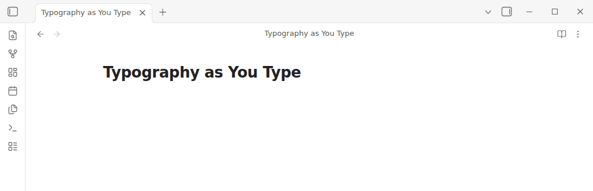
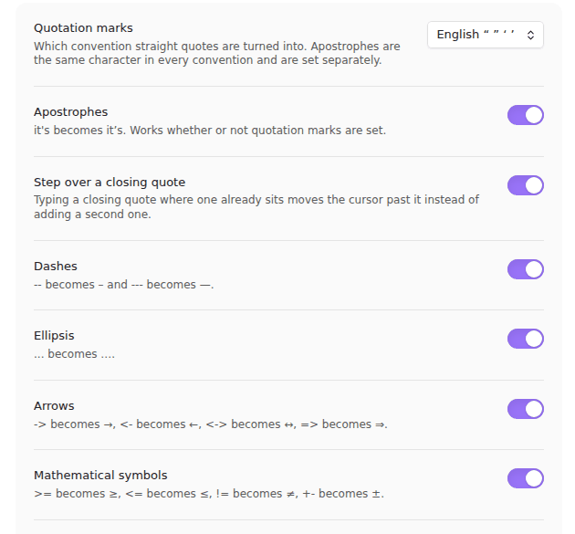

# Typography as You Type

[](https://github.com/perezamadorluisenrique-gif/smart-typography-plugin/releases/latest)
[](https://obsidian.md/plugins?id=typography-as-you-type)
[](https://github.com/perezamadorluisenrique-gif/smart-typography-plugin/actions/workflows/ci.yml)
[](LICENSE)

Straight quotes become curly ones, `--` becomes an en dash, `...` becomes an
ellipsis and `->` becomes an arrow, as you type. Nothing is substituted
inside code, formulas or link targets, and Backspace puts back exactly what
you typed.



This is a rebuild rather than a fork. The plugin it replaces,
[mgmeyers/obsidian-smart-typography][original], has about 170,000 downloads
and has had no release since June 2022. Its open issues are the
specification for this one: the notes below say which issue each behaviour
answers.

[original]: https://github.com/mgmeyers/obsidian-smart-typography

**Interface languages:** English, 简体中文, 日本語, 한국어, Español, Deutsch, Français, Português (Brasil) and Русский, following Obsidian's language setting. A translation that reads wrong? [Open an issue](https://github.com/perezamadorluisenrique-gif/smart-typography-plugin/issues/new/choose) with the text and what it should say.

## What it substitutes

| You type | You get | Group |
| --- | --- | --- |
| `"` | `“` or `”`, by position | Quotation marks |
| `'` | `‘` or `’`, or an apostrophe | Quotation marks, apostrophes |
| `--` | `–` | Dashes |
| `---` | `—` | Dashes |
| `...` | `…` | Ellipsis |
| `->` `-->` | `→` | Arrows |
| `<-` | `←` | Arrows |
| `<->` | `↔` | Arrows |
| `=>` | `⇒` | Arrows |
| `<==` | `⇐` | Arrows |
| `<=>` | `⇔` | Arrows |
| `>=` | `≥` | Mathematical symbols |
| `<=` | `≤` | Mathematical symbols |
| `!=` `/=` | `≠` | Mathematical symbols |
| `+-` `+/-` | `±` | Mathematical symbols |

Each group has its own switch in settings.



`<=` is the one real collision: it is both "less than or equal" and a
leftwards double arrow. With mathematical symbols on it gives `≤`, and
`<==` still reaches `⇐`. With them off, `<=` gives `⇐`.

## Capitals, Tab and wrapping

Three more helpers, all in settings and all safe to ignore:

- **Capitalize sentences** (off by default) types a capital for the first
  letter of a line (after a list marker, task box, `>` or `#`) and after
  `. ` `! ` `? `, closing quotes or brackets included. It stays out of code,
  math, links, tags, paths and addresses, and after abbreviations
  (`e.g.`, `i.e.`, `etc.`, `vs.`, `Mr.`, `Dr.`, `No.`), initials (`J. `)
  and numbers. Backspace right after puts back the lowercase letter.
  Words that start lowercase on purpose, such as `iPhone`, need that
  Backspace.
- **Tab to jump out** (on by default): with the cursor right before a
  closing quote or `) ] } »`, Tab steps past it. In lists, tables, code,
  math, links and with a selection, Tab keeps its usual job.
- **Wrap a selection in quotes** (on by default): with text selected, typing
  `"` or `'` wraps it in the convention's curly quotes instead of replacing
  it, and one undo takes them off. Obsidian already wraps a selection in
  brackets and Markdown marks; this adds the curly quotes.

The first time the plugin loads with no saved settings it offers four style
presets, **Default**, **Writer**, **Academic** and **Developer (quiet)**, and
asks once. They are also in the settings tab, so you can switch later.

## Your own replacements

**Your own replacements** in the settings takes one rule per line: the
characters you type, ` -> `, and what they become.

```
(c) -> ©
(tm) -> ™
:check: -> ✓
```

A rule fires as you type the last character of its sequence, and it goes
through the same engine as the table above: nothing is replaced in code,
formulas, links, front matter, excluded folders or notes with
`typography: off`, and Backspace straight afterwards puts back what you
typed. *Apply typography to the selection or the whole note* uses your rules
too.

- **The built-in rules go first.** A sequence the table above already
  handles, such as `+-`, only uses your rule while that group is switched
  off. A sequence the table rewrites halfway through never appears as
  typed: in `--x` the `--` has become `–` before the `x` arrives, so write
  the rule as `–x`, or switch dashes off.
- **When two of your sequences end at the cursor, the longer one wins**, so
  `ba>` beats `a>` after a `b`. A sequence that extends another one chains
  off it, the way `---` chains off `--`: with `<< -> «` and `<<< -> ⋘`,
  typing `<<<` gives `⋘`, and Backspace gives back all three `<`.
- **Lines that are not rules are listed under the box**, with the reason:
  no ` -> `, a sequence shorter than two characters, only spaces, a
  sequence already on an earlier line. A sequence cannot contain ` -> `
  itself.

Two presets add rules in one click; neither is on until you click it:

| Preset | Rules |
| --- | --- |
| Guillemets | `<<` → `«`, `>>` → `»` |
| Symbols | `(c)` → `©`, `(r)` → `®`, `(tm)` → `™` |

`>>` at the start of a line, after optional spaces or other `>`, opens a
nested blockquote, so none of your rules fires on a `>` typed while the line
so far is only spaces and `>`. `+-` is not in the
symbols preset because the mathematical symbols group already turns it
into `±`.

## Quotation marks in your language

The convention is a dropdown, not a fixed set of curly quotes: English,
German, French, Spanish, Swedish, Polish and Russian, or off. French adds
the no-break space its typography asks for inside the guillemets. This is
what issues [#47], [#64] and [#51] ask for.

The apostrophe is `’` in every convention, which is a separate switch from
the quotation marks. German is the case that makes the difference visible:
it closes a single quotation with `‘`, but `geht's` still takes `’` ([#70]).

A quotation mark opens or closes depending on what precedes it, and the
start of a note counts as an opening position, so a note that begins with a
quotation gets the opening mark ([#65]).

Typing a closing quote where one already sits steps over it rather than
adding a second one, which is what Obsidian's own auto-pairing leaves
behind ([#56], [#57], [#59]).

[#47]: https://github.com/mgmeyers/obsidian-smart-typography/issues/47
[#51]: https://github.com/mgmeyers/obsidian-smart-typography/issues/51
[#56]: https://github.com/mgmeyers/obsidian-smart-typography/issues/56
[#57]: https://github.com/mgmeyers/obsidian-smart-typography/issues/57
[#59]: https://github.com/mgmeyers/obsidian-smart-typography/issues/59
[#64]: https://github.com/mgmeyers/obsidian-smart-typography/issues/64
[#65]: https://github.com/mgmeyers/obsidian-smart-typography/issues/65
[#70]: https://github.com/mgmeyers/obsidian-smart-typography/issues/70

## Where it keeps out

A curly quote in a query is a syntax error, and this is where most of the
original's bug reports come from. Nothing is substituted inside:

- fenced code blocks, which covers Dataview and every other query language
  written in one ([#46]);
- inline code, which covers inline Dataview;
- `$...$` and `$$...$$` formulas, though a lone `$` before a digit or a
  space is read as money and not as an unclosed formula;
- `[[wikilink]]` targets and the `(target)` of a markdown link ([#62]);
- YAML frontmatter;
- `<% ... %>` Templater expressions and `<%* ... %>` scripts, including
  ones that run over many lines ([#39]);
- `<!-- HTML comments -->`, on one line or several, where `--` is usually on
  its way to `-->`;
- HTML tags such as `<span style="color: red">` or ``, up to their `>`, where a curled quote breaks the attribute;
- bare URLs.

`---` alone on a line is left alone too, in a quote or callout as well: it is
a horizontal rule, a setext underline and the frontmatter fence, and none of
those is an em dash. So is the delimiter row of a table, `| --- | :-: |`,
which would stop being one with a dash in it.

### A dash on a quote line of its own

If you end a quotation with a dash on its own last line, switch on **Lone
dashes in quotes and callouts** (off by default). Then `>--` becomes `>–` and
`>---` becomes `>—`, with or without a space after the `>`, in callouts and in
nested quotes (`> >--`) too:

```
> Line before the dash
>–
```

- Only a line that is nothing but quote markers and the hyphens changes. A
  line of hyphens outside a quote is still a horizontal rule or a heading
  underline, front matter stays as it is, and a table's delimiter row inside a
  quote stays a table.
- Inside a quote this gives up `> ---` as a horizontal rule and `> --` under a
  line as a heading underline while you type. Backspace straight after the
  dash puts the hyphens back, and `> ***` is a horizontal rule too.
- *Apply typography* leaves these lines alone even with the option on, so the
  rules already in your notes are not turned into dashes.
- On phones it works with keyboards that send each character as it is typed.
  A keyboard that composes `--` as part of a word leaves it as typed (see
  [Input methods, dead keys and phones](#input-methods-dead-keys-and-phones)).

[#39]: https://github.com/mgmeyers/obsidian-smart-typography/issues/39
[#46]: https://github.com/mgmeyers/obsidian-smart-typography/issues/46
[#62]: https://github.com/mgmeyers/obsidian-smart-typography/issues/62

## Text that is already there

Substitutions happen as you type, so a paragraph pasted from elsewhere, or a
note written before you installed the plugin, keeps its straight quotes and
double hyphens. The command **Apply typography to the selection or the whole
note** fixes that: it works on the selection, or on the whole note when nothing
is selected.

It feeds the text through the same rules as typing, one character at a time,
so the result is exactly what you would have got by typing it: code, maths,
links, front matter and HTML tags are left alone, your quotation style and the
groups you switched off are respected, and text that is already typeset is not
touched again. The change is one step in the undo history.

## The status bar and the right-click menu

The status bar shows the quotation marks the current note gets, such as `“ ”`
or `„ “`, and adds `off` when nothing is substituted there. Hover over it to
see why: the note's `typography-quotes` or `lang` property, Quotes per folder,
another plugin, or your settings, and whether the note is off by its
`typography: off` property or an excluded folder. That answers "why are my
quotes not curling here?" without opening the settings.

Click it for a menu: turn substitutions off or on in this note, set its
quotation marks, and apply typography to the selection or the whole note.
**Show in the status bar** in the settings hides it. Obsidian has no status
bar on phones; the commands do the same there and can go on the mobile
toolbar.

With text selected, the editor's right-click menu has **Apply typography to
the selection**, so a pasted paragraph is one click away from curly quotes.

## Different quotation marks for different notes

If you write in more than one language, the quotation marks can follow the
note instead of one global setting. Each note gets the first of these that
applies:

1. **The note's `typography-quotes` property**, for example
   `typography-quotes: german`. It takes the convention names (`english`,
   `german`, `french`, `spanish`, `swedish`, `polish`, `russian`), readable
   names such as `Deutsch`, language codes such as `de` or `fr-CA`, and `off`
   for straight quotes. The command *Set quotation marks for this note…*
   offers the list and writes the property for you.
2. **The note's `lang` property**, if you turn on *Use the note's lang
   property* (off by default, since your notes may already carry a `lang`).
3. **Quotes per folder** in the settings: one `folder -> convention` per line,
   such as `Deutsch -> german`. The most specific folder wins.
4. **The quotation marks setting**, as before.

A value that names no convention is skipped, so a typo never changes your
quotes. Typing, stepping over a closing quote, wrapping a selection, taking a
substitution back with Backspace and *Apply typography to the selection or the
whole note* all use the note's own convention.

## Turning it off for a folder or a note

- **Excluded folders** in the settings takes one folder per line. Nothing is
  substituted in any note inside them, at any depth: a folder of code
  snippets, raw imports, or templates that must stay plain ([#41]).
- **One note** opts out with the property `typography: off`. The command
  *Turn substitutions off or on in this note* adds or removes it for you.

Everything else about the note (its quotes, dashes and ellipses already in
place) is left as it is; only new typing stops being converted. The *Apply
typography* command still works there when you run it on purpose.

## Undo, and taking a substitution back

Each substitution is one editor transaction covering both the character you
typed and the replacement, so one undo removes the whole thing rather than
leaving half of it behind.

Backspace pressed straight afterwards restores the characters you typed: an
em dash goes back to `---`, not to `--`. That is the escape hatch that makes
the rules safe to leave on.

It only applies at the cursor position the substitution left, and any other
editor transaction, a bare cursor move included, drops the record. The
original reverts on any Backspace, so moving the cursor and then pressing it
rewrites text somewhere else in the note ([#58]).

[#58]: https://github.com/mgmeyers/obsidian-smart-typography/issues/58

## Input methods, dead keys and phones

Nothing is substituted while an input method or a dead key is composing.
The characters that arrive mid-composition are half-finished and the
keyboard revises them afterwards, and rewriting them is what produces the
doubled quotes reported on GNOME ([#44], [#63]).

Once the composition is over, the quotes it produced are curled, each one
where it stands. This matters most on Android, where keyboards such as
Gboard compose every word as you type it, apostrophe included: without
this step `it's` would never become `it’s` there. Only quotes get this
treatment: a keyboard that composes `--` or `...` as part of a word leaves
them as typed.

On iPhone and iPad, iOS has its own **Smart Punctuation** (Settings →
General → Keyboard), on by default, which curls quotes and turns `--` into
an em dash before the plugin sees them. The two work side by side, but iOS
always uses English quotation marks and its own dash rule. For the
convention you picked here, the `--` en dash and Backspace putting back
what you typed, turn Smart Punctuation off.

[#44]: https://github.com/mgmeyers/obsidian-smart-typography/issues/44
[#63]: https://github.com/mgmeyers/obsidian-smart-typography/issues/63

## How it is put together

- `main.ts` is the only file that touches Obsidian or CodeMirror. It holds
  the input handler, the Backspace binding, the state field that remembers
  the last substitution, and the settings tab.
- `src/` is pure logic with no imports from either: `context.ts` decides
  what is protected, `rules.ts` is the table of character substitutions,
  `custom.ts` compiles your own replacements into the same shape,
  `substitute.ts` turns a keystroke into an editor change,
  `quote-dashes.ts` is the opt-in dash on a quote line of its own,
  `note-status.ts` is what the status bar says, `compose.ts`
  curls the quotes a composition left behind, `revert.ts`
  decides whether Backspace should put something back, and `settings.ts`
  holds the conventions.
- `tests/` runs under `node --test` with no test framework and no browser.

```
npm install
npm test
npm run build
```

## Extension API

Another plugin can choose the quotation marks and the dash characters this plugin types for a note. The API
is `app.plugins.getPlugin('typography-as-you-type').api`, and the workspace event
`typography-as-you-type:api-ready` fires (with the API as its argument) when this plugin has loaded.

```ts
const api = app.plugins.getPlugin('typography-as-you-type')?.api;
const stop = api?.registerQuoteResolver((note) =>
  note.path.startsWith('Buch/')
    ? { doubleOpen: '„', doubleClose: '“', singleOpen: '‚', singleClose: '‘', padding: '' }
    : null);
api?.registerDashResolver((note) => (note.path.startsWith('Buch/') ? { en: '—', em: '—' } : null));
```

A resolver gets `{ path }` and returns marks, or `null` to leave the note alone. The newest resolver with an
answer wins, a note's own `typography-quotes` property still wins over any resolver, and a resolver that throws
or answers badly is skipped. Each register call returns a function that undoes it. Resolvers run on keystrokes
a rule reacts to, so keep them quick. With nothing registered, nothing changes.

## What is tested, and where

The 234 tests cover the engine, not the editor. They type through
`substitutionFor` one character at a time, which is how the chained rules
get exercised.

The editor side has been checked inside the Obsidian desktop app (1.13.7,
Linux), with keystrokes sent through Chromium's input pipeline rather than
by calling the plugin directly:

- with Obsidian's "Auto-pair brackets" on, the default, quotation marks are
  curled and not doubled (0.1.1 and earlier lost this to auto-pairing);
- a substitution is one undo step, and Backspace straight afterwards puts
  back what was typed;
- input-method composition, sent through Chromium's own composition API,
  is left alone while it lasts, and its quotes are curled once it is
  committed (`it's` composed as one word, a dead-key `"`);
- the settings tab renders, saves, and applies to open notes at once.

Still not checked: a physical dead-key layout on GNOME and a real Android
or iOS keyboard, which may reach the editor differently from the simulated
composition, and other plugins that also handle typing, Easy Typing among
them ([#66]).

[#66]: https://github.com/mgmeyers/obsidian-smart-typography/issues/66

## What it deliberately does not do

- **Reading-view-only substitution** ([#40], [#67]). That is a different
  plugin: it would render substitutions without changing the note, and
  mixing the two in one settings tab makes both confusing.
- **Superscripts and subscripts** ([#69]), and **unit symbols** ([#73]).
  Both are substitutions of a different kind, and `^2` is live markdown in
  too many vaults to convert by default.
- **Right-to-left quotation order** ([#68]), which needs more than a rule
  table.

[#40]: https://github.com/mgmeyers/obsidian-smart-typography/issues/40
[#41]: https://github.com/mgmeyers/obsidian-smart-typography/issues/41
[#67]: https://github.com/mgmeyers/obsidian-smart-typography/issues/67
[#68]: https://github.com/mgmeyers/obsidian-smart-typography/issues/68
[#69]: https://github.com/mgmeyers/obsidian-smart-typography/issues/69
[#73]: https://github.com/mgmeyers/obsidian-smart-typography/issues/73

## Pro

[Typography Pro](https://perezamadorluisenrique-gif.github.io/pro/typography/) is an optional paid companion (one-time payment, 14-day free trial): profiles that set quotes, dash style and French spacing together for a note, a folder or a `lang`, with Spanish and French dialogue dashes; composing a note, a folder or the whole vault with a preview first and one undo; and an inconsistency check before you publish. Everything described above stays free in this plugin, and this plugin never needs Pro.

| Setting | Default | What it does |
| --- | --- | --- |
| Show Pro tips | on | A one-line tip about Typography Pro in this plugin's settings tab. Off hides it for good. |

**Pro tips (static, inside this plugin only).** Typography as You Type shows one line of text about Typography Pro in one place, its own settings tab: right after you change the quotation marks or apply a style preset. It shows at most once every 14 days. The text is fixed and ships with the plugin: nothing is loaded from the internet, nothing is counted or sent, and **Learn more** only opens the Pro page in your browser. **Don't show again** on the tip, or the **Show Pro tips** setting, turns it off for good.

## Installing

In Obsidian, open Settings -> Community plugins -> Browse, search for
Typography as You Type, then install and enable it.

To install it by hand instead, download `main.js` and `manifest.json` from
the [latest release][releases] into
`<your vault>/.obsidian/plugins/typography-as-you-type/` and enable the plugin in
Settings -> Community plugins.

[releases]: https://github.com/perezamadorluisenrique-gif/smart-typography-plugin/releases

It needs Obsidian 1.3.5 or newer.

## More plugins by Siulved54

| Plugin | What it does | Source |
| --- | --- | --- |
| [Shared Blocks](https://obsidian.md/plugins?id=shared-blocks) | Write a block of text once and reuse it in any note. Edit the source and every reference re-renders live. | [shared-blocks](https://github.com/perezamadorluisenrique-gif/shared-blocks) |
| [Text Case and Cleanup](https://obsidian.md/plugins?id=text-format) | Change case, make camelCase or slugs, sort lines and remove duplicates, and repair text pasted out of a PDF, without touching code or URLs. | [text-format](https://github.com/perezamadorluisenrique-gif/text-format) |
| [Section Numbering](https://obsidian.md/plugins?id=section-numbering) | Number headings as an outline (1, 1.1, 1.2) and keep every link to them working when they renumber. | [section-numbering](https://github.com/perezamadorluisenrique-gif/section-numbering) |
| [Spreadsheet to Table](https://obsidian.md/plugins?id=spreadsheet-to-table) | Paste cells from Excel or Google Sheets as a Markdown table with a real header, insert CSV files, and copy tables back out. | [spreadsheet-to-table](https://github.com/perezamadorluisenrique-gif/spreadsheet-to-table) |
| [Hybrid Line Numbers](https://obsidian.md/plugins?id=hybrid-line-numbers) | Relative and hybrid line numbers for Vim-style jumps, where a folded section counts as one line. | [hybrid-line-numbers](https://github.com/perezamadorluisenrique-gif/hybrid-line-numbers) |
| [List Item Callouts](https://obsidian.md/plugins?id=list-item-callouts) | Colour a single list item as a callout by starting it with a character such as `&`, `!` or `?`. | [list-item-callouts](https://github.com/perezamadorluisenrique-gif/list-item-callouts) |
| [Folder Counts](https://obsidian.md/plugins?id=folder-counts) | See how many notes or files each folder holds, right in the file explorer, with a vault total and folder exclusions. | [folder-counts](https://github.com/perezamadorluisenrique-gif/folder-counts) |
| [Note Reading Time](https://obsidian.md/plugins?id=note-reading-time) | Reading time of the current note or your selection in the status bar, optionally saved to a property. | [note-reading-time](https://github.com/perezamadorluisenrique-gif/note-reading-time) |
| [Task Rollover](https://obsidian.md/plugins?id=task-rollover) | Roll unfinished tasks from your last daily note into today's when it is created, with a real undo. | [task-rollover](https://github.com/perezamadorluisenrique-gif/task-rollover) |
| [Zoom Into Section](https://obsidian.md/plugins?id=zoom-into-section) | Zoom into a heading or list item to see only it and its contents, with a breadcrumb bar to climb back out. | [zoom-into-section](https://github.com/perezamadorluisenrique-gif/zoom-into-section) |
| [Link Title on Paste](https://obsidian.md/plugins?id=link-title-on-paste) | Paste a web address and get a Markdown link with the page's title, fetched in the background and undone in one step. | [link-title-on-paste](https://github.com/perezamadorluisenrique-gif/link-title-on-paste) |
| [Update Radar](https://obsidian.md/plugins?id=update-radar) | Checks your installed community plugins for updates in the background, shows what changed, and flags the ones that look abandoned. | [community-update-checker](https://github.com/perezamadorluisenrique-gif/community-update-checker) |
| [Dataview to Bases](https://obsidian.md/plugins?id=dataview-to-bases) | Convert Dataview queries into Bases blocks, and see which queries in your vault can be converted. | [dataview-to-bases](https://github.com/perezamadorluisenrique-gif/dataview-to-bases) |
| [Line Editing Commands](https://obsidian.md/plugins?id=line-editing-commands) | Duplicate, join, sort and reverse lines, insert blank lines and jump to a line number, with multi-cursor support. | [line-editing-commands](https://github.com/perezamadorluisenrique-gif/line-editing-commands) |
| [Note Mover Rules](https://obsidian.md/plugins?id=note-mover-rules) | Move notes into folders by ordered rules on tags, properties, titles and paths, with a preview before any bulk move. | [note-mover-rules](https://github.com/perezamadorluisenrique-gif/note-mover-rules) |
| [Tab History](https://obsidian.md/plugins?id=tab-history) | Keeps each tab's back and forward history across restarts, and adds commands to move, maximize and close tabs. | [tab-history](https://github.com/perezamadorluisenrique-gif/tab-history) |
| [URL Cards](https://obsidian.md/plugins?id=url-cards) | Shows web addresses as cards with title, description and image, and reads existing cardlink blocks. | [url-cards](https://github.com/perezamadorluisenrique-gif/url-cards) |
| [Vim Config](https://obsidian.md/plugins?id=vim-config) | Loads a vimrc-style file from your vault so your key mappings and editor commands are ready when vim mode starts. | [vim-config](https://github.com/perezamadorluisenrique-gif/vim-config) |
| [Task Archive](https://obsidian.md/plugins?id=task-archive) | Moves completed tasks, with their sub-items, into an archive section or note. | [task-archive](https://github.com/perezamadorluisenrique-gif/task-archive) |
| [Revisit Later](https://obsidian.md/plugins?id=revisit-later) | Link the current note into a future daily note, with a date typed in plain English, so it comes back when you want to review it. | [revisit-later](https://github.com/perezamadorluisenrique-gif/revisit-later) |
| [Explorer Colors Plus](https://obsidian.md/plugins?id=explorer-colors-plus) | Color files and folders in the file explorer, with a palette, cascading to children, and import from File Color. | [explorer-colors-plus](https://github.com/perezamadorluisenrique-gif/explorer-colors-plus) |
| [Book Lookup](https://obsidian.md/plugins?id=book-lookup) | Create book notes from Open Library or Google Books, with cover images, ISBN search and Book Search compatible templates. | [book-lookup](https://github.com/perezamadorluisenrique-gif/book-lookup) |
| [Web Search Menu](https://obsidian.md/plugins?id=web-search-menu) | Search the web for selected text or the note title from the right-click menu, with engines you define. | [web-search-menu](https://github.com/perezamadorluisenrique-gif/web-search-menu) |
| [Word Lookup](https://obsidian.md/plugins?id=word-lookup) | Look up any word in a sidebar dictionary with definitions, phonetics, synonyms and antonyms, or create a note for it. | [word-lookup](https://github.com/perezamadorluisenrique-gif/word-lookup) |
| [Quick Translate](https://obsidian.md/plugins?id=quick-translate) | Translate the selection or a whole note into another language with no account, keeping links, code and front matter untouched. | [quick-translate](https://github.com/perezamadorluisenrique-gif/quick-translate) |
| [Dice Rolls](https://obsidian.md/plugins?id=dice-rolls) | Inline dice rolls you click to reroll, in Live Preview and Reading view, with full dice notation, a roll dialog and a roll history. Reads Dice Roller notes. | [dice-rolls](https://github.com/perezamadorluisenrique-gif/dice-rolls) |
| [Claude Studio](https://obsidian.md/plugins?id=claude-studio) | Notion-style AI writing, chat and vault tools powered by your local Claude Code CLI. | [claude-studio](https://github.com/perezamadorluisenrique-gif/claude-studio) |
| [Book Studio](https://obsidian.md/plugins?id=book-studio) | Turn notes into a print-ready paperback PDF and an EPUB 3, entirely on your device. | [book-studio](https://github.com/perezamadorluisenrique-gif/book-studio) |
| [Emoji Search](https://obsidian.md/plugins?id=emoji-search) | Insert emojis from a searchable picker or by typing a :shortcode. | [emoji-search](https://github.com/perezamadorluisenrique-gif/emoji-search) |
| [Inline TOC](https://obsidian.md/plugins?id=inline-toc) | Show a live table of contents inside any note with a toc code block, or insert a plain Markdown one. | [inline-toc](https://github.com/perezamadorluisenrique-gif/inline-toc) |
| [Run Code Blocks](https://obsidian.md/plugins?id=run-code-blocks) | Adds a Run button to code blocks and shows the output right below, for JavaScript, Python, shell and more. | [run-code-blocks](https://github.com/perezamadorluisenrique-gif/run-code-blocks) |
| [Canvas Finder](https://obsidian.md/plugins?id=canvas-finder) | Fuzzy-search the cards and files on a canvas and jump straight to the match. | [canvas-finder](https://github.com/perezamadorluisenrique-gif/canvas-finder) |
| [Folder Index Notes](https://obsidian.md/plugins?id=folder-index-notes) | Keeps an index note in each folder up to date with links to the notes and subfolders inside it. | [folder-index-notes](https://github.com/perezamadorluisenrique-gif/folder-index-notes) |
| [Random Note Filters](https://obsidian.md/plugins?id=random-note-filters) | Open or link a random note from a folder, tag, property or the current search results. | [random-note-filters](https://github.com/perezamadorluisenrique-gif/random-note-filters) |
| [Split by Heading](https://obsidian.md/plugins?id=split-by-heading) | Split a note into one note per heading, with links back in the source. | [split-by-heading](https://github.com/perezamadorluisenrique-gif/split-by-heading) |

All of them are in the community directory: Settings -> Community plugins ->
Browse, then search for the name. Demos and install links for every one:
[the catalog](https://perezamadorluisenrique-gif.github.io/catalog/).

### Pro and templates

Optional paid extras, one-time payment. Everything in the free plugins stays free.

- [Update Radar Pro](https://perezamadorluisenrique-gif.github.io/pro/update-radar/): A copy before every update, undo a whole update session, safe start after a broken update.
- [Book Studio Pro](https://perezamadorluisenrique-gif.github.io/pro/book-studio/): Genre themes, a back-of-book index, box sets, several editions and a sales kit for Book Studio.
- [Section Numbering Pro](https://perezamadorluisenrique-gif.github.io/pro/section-numbering/): Numbering profiles, cross-references, multi-note documents and Word export.
- [Typography Pro](https://perezamadorluisenrique-gif.github.io/pro/typography/): Your own typography profiles and dialogue dashes for Typography as You Type.
- [Text Case Pro](https://perezamadorluisenrique-gif.github.io/pro/text-case/): Vault-wide find and replace and per-folder recipes for Text Case.
- [Dataview to Bases Pro](https://perezamadorluisenrique-gif.github.io/pro/dataview-to-bases/): Fixes property types and checks the values before you switch to Bases.
- [KDP Book Vault](https://perezamadorluisenrique-gif.github.io/pro/kdp-book-vault/): A ready-made book vault for Book Studio, with two sample books.
- [Thesis and Report Vault](https://perezamadorluisenrique-gif.github.io/pro/thesis-vault/): A thesis and report vault numbered with Section Numbering.
- [Writer bundle](https://perezamadorluisenrique-gif.github.io/pro/bundles/writer/): Typography Pro and Text Case Pro together.
- [Author bundle](https://perezamadorluisenrique-gif.github.io/pro/bundles/author/): Book Studio Pro, KDP Book Vault and Typography Pro together.
- [Academic bundle](https://perezamadorluisenrique-gif.github.io/pro/bundles/academic/): Section Numbering Pro, the Thesis and Report Vault and Typography Pro together.
- [All Obsidian bundle](https://perezamadorluisenrique-gif.github.io/pro/bundles/all-obsidian/): Every Obsidian Pro and template in one purchase.

Follow new plugins and updates on X: [@luenpereza](https://x.com/luenpereza)

## Licence

MIT, (c) Siulved54.
